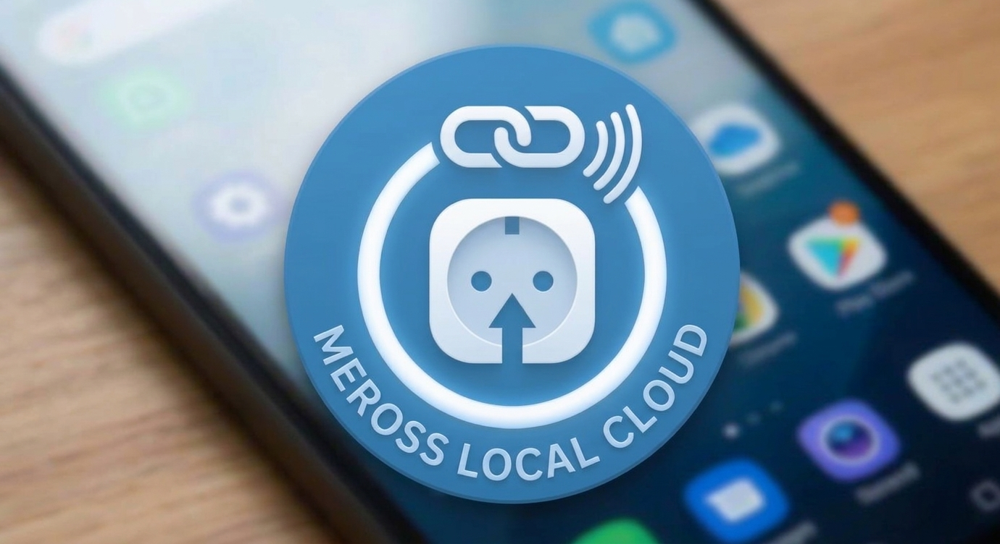

**English** · [Français](README.fr.md)

# Meross Local Cloud — Home Assistant integration for a local broker

> **Upgrading from 3.x?** Version 4.0.0 changes the Home Assistant domain from
> `meross_cloud` to `meross_local_cloud`. Remove the old integration entry and
> reinstall it; follow the [migration guide](docs/MIGRATION-4.0.md).



**Unofficial** Home Assistant integration, distributed via HACS. It controls
Meross devices paired to a local broker, without using the Meross cloud for
daily operation. Only local mode is supported: no official cloud credentials
are requested or used.

Since 3.0, the integration is **driven by the broker's device profiles**. It no
longer depends on `meross_iot`: a profile describes namespaces, payload paths,
entities and commands, and the broker publishes the signed catalog. Adding a
device family no longer requires an integration release, only a profile on the
broker side.

Families currently described: MRS100, MSS310, MSS425/MSP844 power strips,
MSH300 with MS100/MS130/MTS100/MS200/MS400/GS559/MST subdevices,
MTS200/MTS300/MTS9, MS600, MSL lights, MSS plugs, MSS5 dimmer, MOD/MSXH0
diffusers, MAP100 purifier, EM/EM06 energy meters, MSG/RSG garage doors and
HP110.

- for the MRS100: `number` entities for open/close durations (typed fields), a
  Position slider, **Start calibration** / **Stop calibration** buttons, a
  **Calibration status** sensor, and a cover icon driven by movement (arrows
  while moving, open/closed/partial at rest);
- reliable removal of forgotten devices (Unbind), repairs for devices missing
  for 48 h and for “device without profile”.

## Devices and testers wanted

The **MRS100** is the reference device for this setup. The other families in
the catalog (power strips, sensors, GS559, garage doors, purifier, MST, energy
meters, MSXH0, HP110, MTS9, etc.) are described from the protocol and traces,
but **need testers on real hardware**. Open an
[issue](https://github.com/mazkagaz/meross-local-cloud/issues) with the model,
firmware and the functions that work or fail: that is what makes it possible to
validate each profile. The MRS100 is not a prerequisite: any family in the
catalog can be tested.

**Stable version 4.0.8**, compatible with broker **1.3.0** (1.4.6 recommended
for MRS100 icons, 1.4.8 for Position and typed durations) and pairer **2.0.9**.

## The three building blocks

| Component | Role | Repository |
|---|---|---|
| **Meross Local Broker** | add-on: MQTT broker + local API | [mazkagaz/meross-local-broker](https://github.com/mazkagaz/meross-local-broker) |
| **Meross Local Cloud** | this Home Assistant integration (HACS) | [mazkagaz/meross-local-cloud](https://github.com/mazkagaz/meross-local-cloud) |
| **Meross Local Pairer** | Android pairing app | [mazkagaz/meross-local-pairer](https://github.com/mazkagaz/meross-local-pairer) |

```
MRS100 ──MQTT/TLS──> Meross Local Broker add-on ──API/MQTT──> this integration
                            ^
                            │ initial pairing
                       Meross Local Pairer (Android)
```

## Version compatibility

| Component | Minimum version | Notes |
|---|---|---|
| Meross Local Cloud | 4.0.8 | this integration, profile engine 2.6 |
| Meross Local Broker | 1.3.0 | full catalog; 1.3.1 shutter fix; 1.4.6 MRS100 icons; 1.4.8 Position; **1.5.0 for HA Container**; **1.6.2 for MSL610**, **1.6.3 for Clock sync** |
| Meross Local Pairer | 2.0.9 | HTTPS 2004 only |
| Home Assistant | 2025.6 | tested with 2026.10 (latest harness; 2026.11 pending support) |

## Beta channel

Stable versions are published from `main`. Test versions are `X.Y.Z-beta.N`
**pre-releases** from the `dev` branch: to see and install them in HACS, enable
**“Show beta versions”**. Without that option, only stable versions are
offered. Full procedure: [docs/operations/RELEASING.md](docs/operations/RELEASING.md).

Technical documentation is indexed in [docs/README.md](docs/README.md)
(currently in French; the English translation is in progress).

## Before you start

| Your setup | Broker | This integration |
|---|---|---|
| Home Assistant OS or Supervised | install the **add-on** | install with HACS |
| Home Assistant Container | run the **Docker broker** ([guide](https://github.com/mazkagaz/meross-local-broker/blob/main/docs/guides/DOCKER.md)) | install with HACS, configure manually |

Common prerequisites:

1. A broker is installed and running (add-on or Docker container).
2. A **local account** has been created in the broker (login and password).
   Do not use your official Meross account: this account is independent.
3. At least one Meross device (MRS100 or another family in the catalog) has
   been paired with **Meross Local Pairer**.
4. **HACS** is installed in Home Assistant.
5. Home Assistant 2025.6 or newer (tested with 2026.10 (latest harness; 2026.11 pending support)).

## Install with HACS

Open **HACS → Integrations**, search for **Meross Local Cloud**, open the entry
and download the latest version, then restart Home Assistant.

If the entry does not appear (older HACS version or cache), add it as a custom
repository:

[](https://my.home-assistant.io/redirect/hacs_repository/?owner=mazkagaz&repository=meross-local-cloud&category=integration)

Click the badge above, or:

1. Open **HACS → Integrations**.
2. Open the **⋮ → Custom repositories** menu.
3. Add:
   - URL: `https://github.com/mazkagaz/meross-local-cloud`
   - Category: **Integration**
4. Open the **Meross Local Cloud** entry and download the latest version.
5. Restart Home Assistant.

HACS installs the integration, not the broker. On Home Assistant OS or
Supervised the broker is the add-on; on Home Assistant Container it is the
standalone Docker container.

## Home Assistant Container

The broker add-on needs the Supervisor. On **Home Assistant Container**, run
broker **1.5.0 or newer** as a standalone Docker container:
[Docker guide](https://github.com/mazkagaz/meross-local-broker/blob/main/docs/guides/DOCKER.md).
The integration is installed with HACS as usual, then configured manually with
the broker host and the local account; HTTPS and MQTT default to 2004/2001.

## Add the integration

1. **Settings → Devices & services → Add integration**.
2. Search for **Meross Local Cloud**.
3. The wizard discovers the broker over mDNS and shows a single form:

| Field | Value |
|---|---|
| Meross Local Broker address | host or IP, without `https://` (pre-filled when detected) |
| HTTPS port | `2004` (detected or default) |
| MQTT port | `2001` (detected or default) |
| Local login | the broker's local account |
| Password | the local password |

Above the fields, a generic example is shown:
`Example: 192.168.1.10 — HTTPS 2004, MQTT 2001`.

- Broker detected: the fields are pre-filled and “Broker detected
  automatically” is shown in green.
- Broker not detected: the fields are empty and “Broker not detected” is shown
  in red, followed by the link
  **Install or check the Meross Local Broker add-on installation** to
  `https://github.com/mazkagaz/meross-local-broker#readme`.

4. Confirm. Devices already paired appear with their entities.

The broker must be **1.2.2 or newer** for ACK routing and the profile catalog;
**1.3.0** is required for the new families (power strips, sensors, garage
doors, purifier, MST, EM, MSXH0, HP110, MTS9). Its local CA is valid: it is
downloaded from `/ca.crt`, verified and pinned by the integration, then used
for HTTP and MQTT (hostname verification is included when the certificate
covers the configured address).

Unencrypted HTTP (port 2003) and the “ignore certificate validation” options
have been **removed**: every connection uses TLS with a valid CA. An old broker
(invalid CA) must be updated before configuring the integration.

The local login does not have to be an email address: a simple username is
enough. **Never use official Meross cloud credentials**; the integration only
contacts the local broker.

## Forgetting a device

- When the broker publishes `Appliance.Control.Unbind`, the device, its
  subdevices and its entities are removed from Home Assistant immediately.
- A device absent from all successful HTTP polls for **48 hours** triggers a
  “Device no longer paired” repair. Confirming it removes the device and its
  entities; if the device comes back, the repair is cancelled.
- Entries inherited from older versions are reconciled at startup and follow
  the same 48 h delay. To clean up immediately, delete the device in
  **Settings → Devices**.

## Profile backend

The broker publishes a signed catalog (Ed25519). At startup and whenever the
revision changes, the integration:

1. verifies the signature and loads the profiles;
2. queries each device (`System.All`/`Ability`);
3. matches the device to the most specific profile;
4. creates the entities and starts one scheduler per device.

A device without a profile creates no entities and triggers an **No profile
for …** repair. Fixing or adding the profile in the broker catalog is enough.
When the revision changes, the integration advertises the update: a persistent
notification appears and the profile `update` entity offers **Install**. The
installation remains manual so you can choose the moment; no automatic reload
is performed.
To prepare a profile, see the overrides/capture workflow in the broker
repository.

Local MQTT commands use a limit suitable for the local broker (1 message/s
sustained, burst of 5 over 5 s per device) instead of the cloud limit of 200
messages/hour.

## Integration options

In **Settings → Devices & services → Meross Local Cloud → Configure**:

- **Custom HTTP User-Agent**: leave empty unless you need a specific value.
  Changing it reloads the integration so it applies to all HTTP calls.

Diagnostics (**Settings → Devices & services → Meross Local Cloud → Download
diagnostics**) are redacted: credentials hidden, CA, server certificate,
devices, profile backend state (revision, signature, matched/unmatched
devices, errors) and scheduler counters. Logs pseudonymize UUIDs, MAC
addresses, IPs, emails and secrets, so they can be pasted into an issue without
manual masking.

## Entities created

| Entity | Purpose |
|---|---|
| `cover.*` | open, close, position |
| `number.*position*` | position slider, 0–100 % |
| `number.*open*` | opening duration (10–120 seconds) |
| `number.*close*` | closing duration (10–120 seconds) |
| `button.*start_calibration*` | start calibration |
| `button.*stop_calibration*` | interrupt calibration |
| `sensor.*calibration_status*` | `success`, `timeout`, `motor_blocked`, `failed_N` |

## Usage

- **Durations**: edit the `number` entities. The add-on persists the values
  and re-applies them after the shutter reconnects.
- **Position**: use the slider or the cover entity; both stay in sync.
- **Calibration**: start **Start calibration**. The scheduler refreshes
  `Adjust` after the command; the sensor then shows the status returned by the
  device (`success`, `timeout`, `motor_blocked`, `failed_N`).
- **Stop calibration**: interrupts the current movement.

## Update

HACS → Integrations → Meross Local Cloud → **Update**, then restart Home
Assistant. A new GitHub release is published for each version.

## Troubleshooting

| Problem | Check |
|---|---|
| HACS cannot find the repository | public repository, **Integration** category, published release |
| No device discovered | add-on running, device ONLINE, correct local account |
| HTTP connection error | broker address and HTTPS port `2004` (TLS required) |
| HTTPS certificate rejected | update the broker to 1.3.0 (valid CA) |
| MQTT error | `…:2001` address; broker 1.3.0 required |
| Entities missing | check the “device without profile” repair and the broker catalog |
| Device without profile | add or fix the profile in the catalog; notification then **Install** on the `update` entity |
| Ghost entities after forgetting | Unbind (≤ 60 s), 48 h repair, or delete the device manually |
| Calibration status stuck | check the add-on logs and the `Calibration status` sensor |

## Development tools

Profiles and golden frames rely on
[meross_lan](https://github.com/krahabb/meross_lan) (**MIT**): its vendored
`merossclient` (v6.0.2, pinned commit) provides the protocol and descriptors,
and its `emulator_traces/` traces are the reference for families without a
local capture. meross_lan is not a runtime dependency; it is used for design,
tests and profile validation. See `NOTICE`, `MODIFICATIONS.md` and
`vendor/merossclient/UPSTREAM.md`.

## Origin, license and history

Unofficial fork of
[albertogeniola/meross-homeassistant](https://github.com/albertogeniola/meross-homeassistant),
created by Alberto Geniola, under the **MIT license**. The original copyright
and license notice are kept in `LICENSE`, with a line for the fork changes.
See also `NOTICE`, `MODIFICATIONS.md` and `LEGAL.md`.

This fork is neither affiliated with, approved by, nor sponsored by Meross or
the upstream author. Meross is a trademark of its respective owner.
