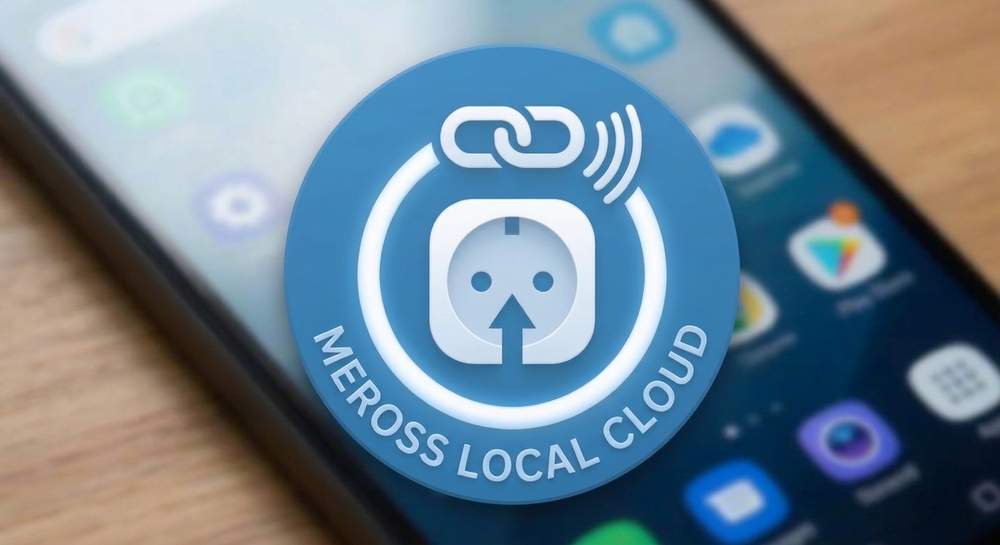

# Meross Local Cloud — broker local (fork)

Intégration Home Assistant non officielle pour piloter des appareils Meross
appairés à un **broker local**, sans cloud Meross au quotidien. Seul le mode
local est proposé : aucun identifiant du cloud officiel n'est utilisé.

## Installation rapide

1. Installer d'abord l'add-on
   [Meross Local Broker](https://github.com/mazkagaz/meross-local-broker).
2. Appairer l'appareil avec
   [Meross Local Pairer](https://github.com/mazkagaz/meross-local-pairer).
3. Dans HACS : **Intégrations → ⋮ → Dépôts personnalisés**, ajouter
   `https://github.com/mazkagaz/meross-local-cloud` en catégorie **Integration**.
4. Télécharger l'intégration, redémarrer Home Assistant.
5. **Paramètres → Appareils et services → Ajouter une intégration →
   Meross Local Cloud**, puis saisir :
   - HTTP : `http://homeassistant.local:2003`
   - MQTT : `homeassistant.local:2001`
   - le **login local** de l'add-on (un nom d'utilisateur suffit, ce n'est pas
     obligatoirement un email)
   - **Skip MQTT certificate validation** coché.

N'utilisez pas les identifiants du cloud Meross officiel : l'intégration ne
contacte que le broker local.

## Apports du fork

- entités `number` pour les durées d'ouverture et de fermeture ;
- boutons de démarrage/arrêt de calibration ;
- capteur de statut de calibration.

La procédure détaillée, les entités et le dépannage sont dans le
[README](https://github.com/mazkagaz/meross-local-cloud#readme).

## Licence

MIT. Fork non officiel de
[albertogeniola/meross-homeassistant](https://github.com/albertogeniola/meross-homeassistant) ;
attribution conservée dans `LICENSE`, `NOTICE` et `MODIFICATIONS.md`.
